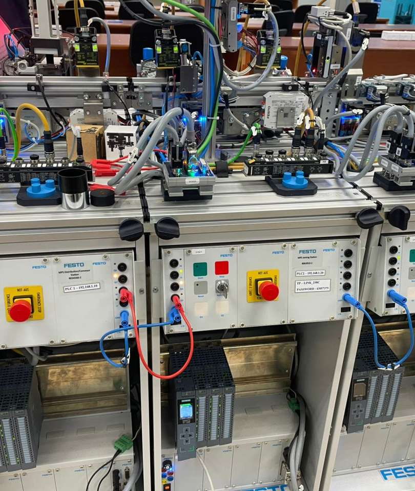
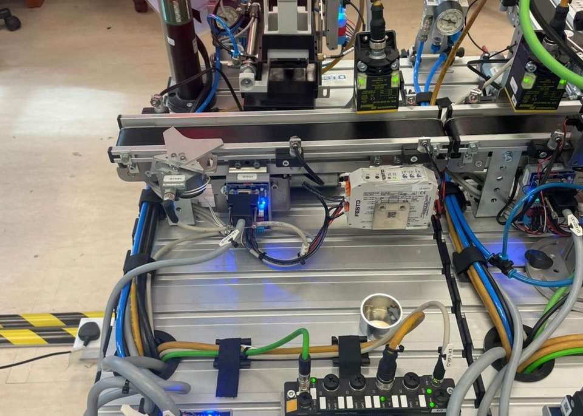
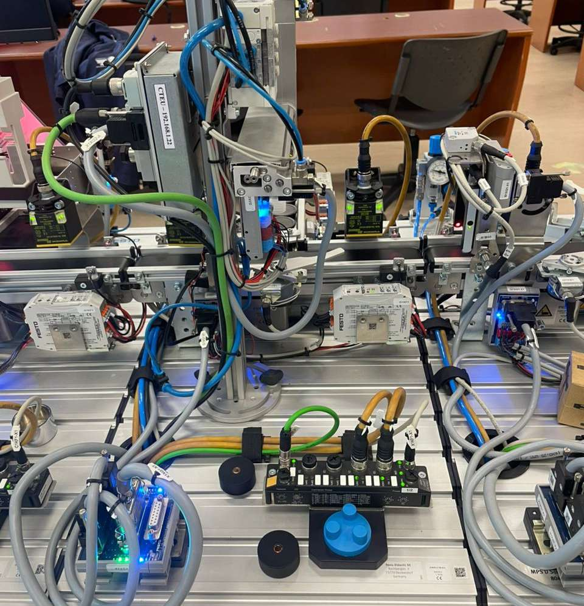
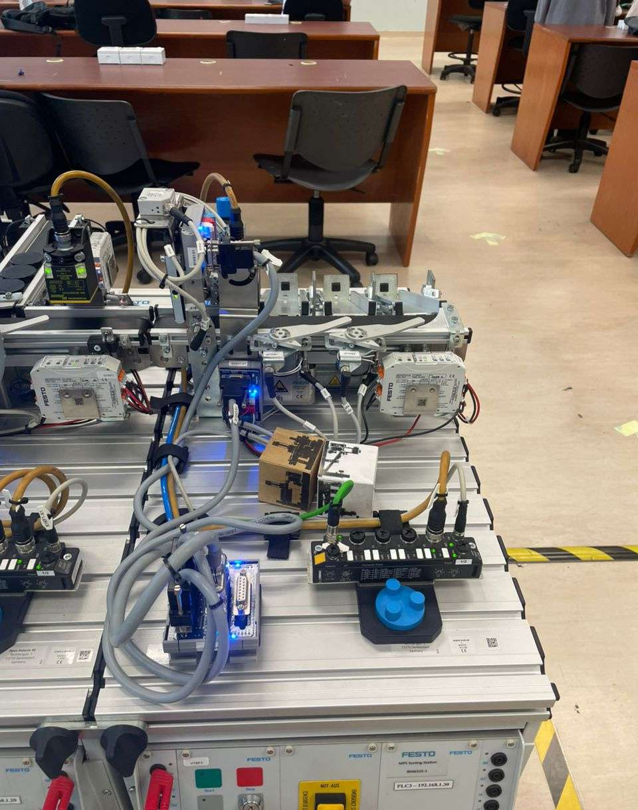
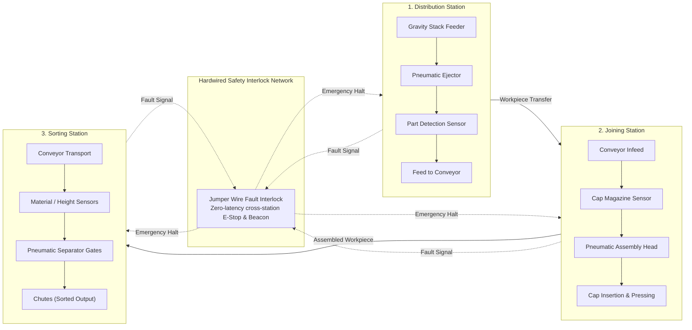
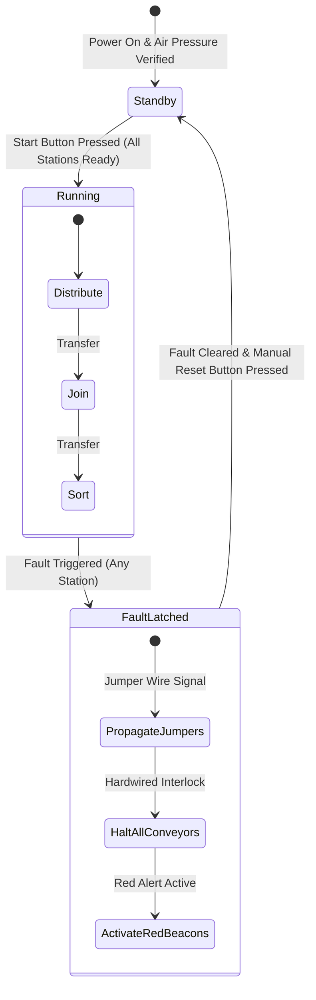

# 🏭 Automated Modular Conveyor Assembly & Sorting System

[](https://new.siemens.com/)
[]()
[](https://www.festo.com/)
[]()
[-blue.svg)]()

> Developed for **NMT12505: Industrial Automation II**, Faculty of Electronic Engineering Technology, Universiti Malaysia Perlis (UniMAP).

---

## 📌 Project Overview

This project presents a multi-station automated industrial manufacturing cell based on the **Festo Modular Production System (MPS)** and controlled via **Siemens PLC** using **Totally Integrated Automation (TIA) Portal V16**.

The system automates the complete lifecycle of a workpiece: continuous automated feeding, precision cap placement and pressing, and automated multi-criteria sorting. A key technical highlight of this design is its **hardwired safety interlock architecture**, which ensures fail-safe synchronization and zero-latency fault propagation across all three stations.

<div align="center">
  
  <p><em>Figure 1: Complete 3-Station Festo MPS Conveyor Assembly & Sorting Manufacturing Line</em></p>
</div>

### Station Modules

| 1. Distribution Station | 2. Joining Station | 3. Sorting Station |
|:---:|:---:|:---:|
| <br/><b>Workpiece Gravity Feeder & Ejector</b> | <br/><b>Pneumatic Cap Placement & Pressing</b> | <br/><b>Multi-Sensor Identification & Deflector Chutes</b> |

---

## ⚙️ 3-Station Automated Manufacturing Architecture

<div align="center">

<details>
<summary align="center"><b>📐 Click to expand Station Process Flow Diagram</b></summary>

<br/>



</details>

</div>

### 1. Distribution Station
- **Function:** Automatically dispenses raw cylindrical workpieces onto the conveyor at a calibrated pace.
- **Actuation:** Double-acting pneumatic cylinder with reed position switches.
- **Fault Detection:** Starvation detection logic triggers if no workpiece is detected by optical sensors within 3.0 seconds.
- **Safety Action:** Immediately halts the local conveyor, flashes the red fault beacon, and locks out the cycle until manually acknowledged.

### 2. Joining Station
- **Function:** Positions a capping module directly above passing workpieces, dispensing and pressing assembly caps into place.
- **Actuation:** Vertical pneumatic press actuator and magnetic parts gripper.
- **Fault Detection:** Optical cap presence verification verifies cap inventory before commencing pressing cycle.
- **Safety Action:** Prevents incomplete assemblies; triggers immediate stoppage if cap feeder jams or runs empty.

### 3. Sorting Station
- **Function:** Inspects finished assemblies using optical and inductive sensors, deflecting components into distinct sorting chutes.
- **Actuation:** Pneumatic deflector gate cylinders controlled via solenoid valve manifolds.
- **Fault Detection:** Gate position feedback sensor monitoring; detects workpiece accumulation or jam conditions.
- **Safety Action:** Halts upstream feed if accumulation threatens to jam the separation junction.

---

## 🛡️ Safety & Fault Propagation Architecture

<div align="center">

<details>
<summary align="center"><b>🚨 Click to expand Safety & Fault Latched State Diagram</b></summary>

<br/>



</details>

</div>

### Why Hardwired Jumper Safety Interlocking?
Rather than relying exclusively on networked software messaging (which introduces bus cycle latency and CPU communication overhead), the three stations incorporate **hardwired interlock jumpers**:
- **Instantaneous Reaction:** Fault signals propagate with negligible latency across all physical stations.
- **Fail-Safe Integrity:** If any station experiences a failure (jam, missing component, or pneumatic pressure drop), the interlock line pulls low/high to immediately trip conveyor contactors and solenoid enable lines.
- **Enforced Operator Protocol:** Requires manual inspection, fault clearance, and physical reset button actuation before resuming production.

---

## 📊 Root Cause Analysis & Maintenance Matrix

| Station | Fault Condition | Root Cause Analysis | Corrective & Preventive Action |
|---|---|---|---|
| **Distribution** | Workpiece missing error (timeout > 3s) | Feeder magazine empty, workpiece jamming, optical sensor lens fouled | Clear feeder chute; replenish raw stock; add low-stock warning switch. |
| **Joining** | Cap missing during insertion cycle | Cap track misaligned, insufficient pneumatic pressure, empty cap tray | Inspect pneumatic pressure regulator; calibrate cap feeder track and presence sensor. |
| **Sorting** | Separator gate failure to open | Cylinder seal friction, solenoid valve coil burnout, mechanical obstruction | Test pneumatic valve operation; check reed switch alignment; clear debris from chutes. |

---

## 📁 Repository Structure

```
PLC_MultiStationAssemblyAndSorting-WithFestoMPSAndSiemensPLC/
├── assets/                           # High-res hardware and station photos
├── plc/
│   └── MiniProject_AziziFarid v4.zap16         # Siemens TIA Portal V16 project archive
│                                      # Includes PLC tags, ladder logic, CTEU GSDML Profinet configuration
└── README.md                         # Repository documentation
```

---

## 🔧 How to Open the Project in TIA Portal

### 1. Clone the Repository

```bash
git clone https://github.com/aziziyahya/PLC_MultiStationAssemblyAndSorting-WithFestoMPSAndSiemensPLC.git
cd PLC_MultiStationAssemblyAndSorting-WithFestoMPSAndSiemensPLC
```

### Compatibility
- **Software:** Siemens **TIA Portal V16** or higher (V17, V18, V19 will prompt an automatic project upgrade upon opening).
- **Target Controller:** Siemens **SIMATIC S7-1500 (CPU 1512C-1 PN)**.

### Steps to Open

1. **Launch TIA Portal:**
   - Open Siemens TIA Portal V16 (or newer).
2. **Retrieve the Project:**
   - In the top menu, go to **Project > Retrieve...**
   - Select `plc/MiniProject_AziziFarid v4.zap16` from this repository.
   - Choose a target destination folder to extract the project.
3. **Open & View Ladder Logic:**
   - Once extracted, TIA Portal will open the project (`MiniProject_AziziFarid v4`).
   - In the Project tree on the left, navigate to:
     - **PLC_1 > Program blocks > Main [OB1]** to inspect the Ladder Logic (LAD) for conveyor control, station sequencing, and safety interlocks.
     - **PLC_1 > PLC tags > Show all tags** to view the physical sensor inputs, actuator outputs, and fault flags.
4. **Run Simulation (Optional):**
   - Click **Start simulation** (or **Online > Simulation > Start**) to test and monitor the logic using **S7-PLCSIM** without physical hardware.

---

## 👥 Project Contributors

Developed as part of **NMT12505: Industrial Automation II** within the **Industrial Electronic Automation Programme**, Faculty of Electronic Engineering Technology, **Universiti Malaysia Perlis (UniMAP)**:

| Contributor | Matric ID | Focus Area |
|---|---|---|
| **Nik Mohamad Azizi Bin Nik Yahya** | `241503239` | PLC Logic & Safety Interlocks |
| **Muhammad Farid Irfan Bin Suhaimi** | `241503230` | Station Integration & Hardware |

